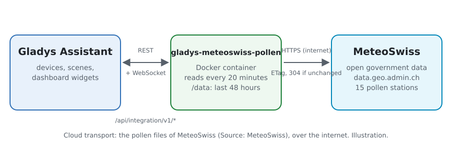
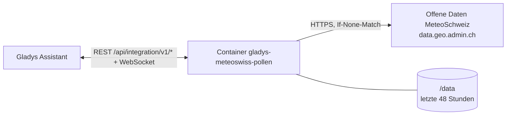
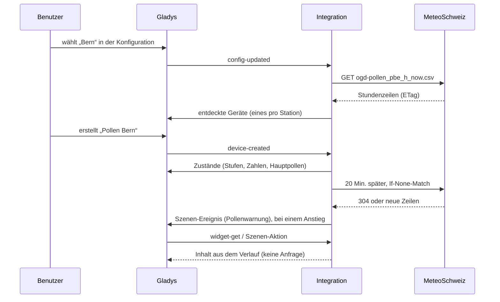
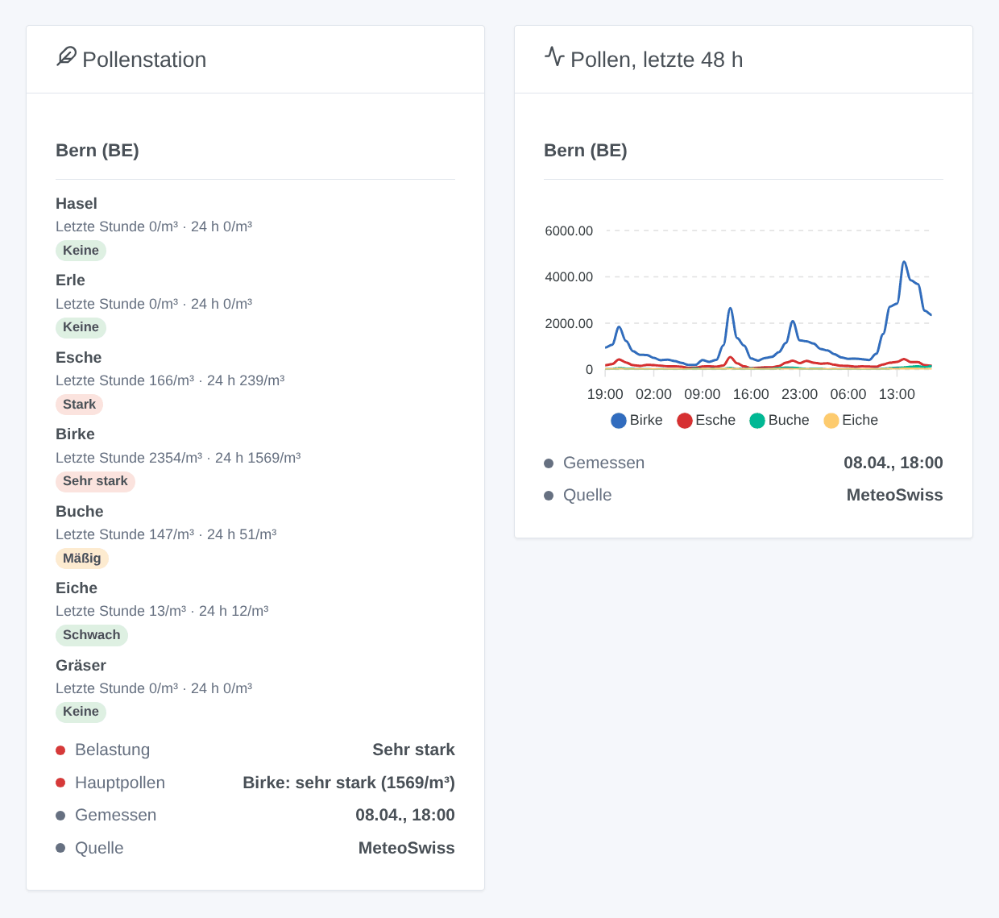

# Gladys MeteoSwiss Pollen

[English](README.md) · [Français](README.fr.md) · **Deutsch** · [Español](README.es.md)

[](LICENSE)
[](https://github.com/William-De71/gladys-meteoswiss-pollen/releases)
[](https://github.com/William-De71/gladys-meteoswiss-pollen/actions/workflows/release.yml)
[](https://gladysassistant.com)


Externe Integration für [Gladys Assistant](https://gladysassistant.com) mit den **stündlich von MeteoSchweiz gemessenen Pollen** an den Stationen des nationalen Pollenmessnetzes: Hasel, Erle, Esche, Birke, Buche, Eiche und Gräser, mit ihrer Belastung von keine bis sehr stark. Offene Behördendaten: ohne Konto, ohne Schlüssel.

Benutzerdokumentation: [English](docs/en.md) · [Français](docs/fr.md) · [Deutsch](docs/de.md) · [Español](docs/es.md).

> Community-Integration, nicht mit MeteoSchweiz verbunden. Quelle der Daten: MeteoSchweiz. Es sind Messwerte, keine Prognose.

## Funktionen

- **Ein Gerät pro Station**, bis zu drei der 15 Stationen mit Echtzeitwerten: Basel, Bern, Buchs SG, Davos, Genève, La Chaux-de-Fonds, Lausanne, Locarno, Lugano, Luzern, Münsterlingen, Neuchâtel, Payerne, Sion, Zürich.
- Aktuelle **Pollenbelastung** (0 keine bis 4 sehr stark). Für jede der sieben Pollenarten: die **Zahl der letzten Stunde** (Pollen pro m³) und ihre **Belastung** über die letzten 24 Stunden. Dazu der **Hauptpollen** als Text.
- Stufen nach den **Belastungsklassen von MeteoSchweiz**, Pollenart für Pollenart.
- **1 Szenen-Auslöser**, **1 Szenen-Aktion** und **2 Dashboard-Widgets** (siehe unten).
- Abfrage alle 20 Minuten mit bedingten Anfragen (eine unveränderte Datei antwortet 304); die letzten 48 Stunden bleiben über Neustarts erhalten.
- Vier Sprachen überall: Englisch, Französisch, Deutsch, Spanisch.

## Funktionsweise





MeteoSchweiz veröffentlicht eine CSV-Datei pro Station in der STAC-Sammlung `ch.meteoschweiz.ogd-pollen`. Die Datei enthält eine Zeile pro Stunde mit der mittleren Konzentration jeder Pollenart. Die Zeiten sind in UTC und markieren das Ende der Stunde. Die Integration liest die Echtzeitdatei jeder Station (`…_h_now.csv`, etwa 2 KB) alle 20 Minuten, mit einem festen Versatz von höchstens fünf Minuten. Sie führt die Zeilen in einem 48-Stunden-Verlauf zusammen und berechnet die Stufen aus dem Mittel der letzten 24 Stunden. Sind weniger als 24 Stunden gespeichert (erster Start, langer Ausfall), liest sie einmal die Jahresdatei der Station (`…_h_recent.csv`, etwa 270 KB), höchstens alle sechs Stunden. Die MeteoSchweiz-Abkürzung der Station (PBE, PZH…) identifiziert das Gerät.



### Transport

Nur Cloud (`"transports": ["cloud"]`): Der Katalog zeigt das Cloud-Abzeichen. Die Integration liest `data.geo.admin.ch`, die Plattform für offene Daten des Bundes. Nur die Anfragen nach den Stationsdateien verlassen Ihr Netzwerk. Es gibt keine lokale Alternative, daher keinen Knopf „Lokale Verbindung bevorzugen“.

## Geräte und Funktionen

| Funktion                              | Kategorie / Typ             | Werte                                   |
| ------------------------------------- | --------------------------- | --------------------------------------- |
| Pollenbelastung                       | `airquality-sensor` / `aqi` | 0 keine … 4 sehr stark (höchste Art)    |
| Pollen Hasel … Gräser (letzte Stunde) | `airquality-sensor` / `aqi` | Pollen pro m³, 0 … 20 000, ohne Einheit |
| Belastung Hasel … Gräser              | `airquality-sensor` / `aqi` | 0 … 4, Mittel der letzten 24 Stunden    |
| Hauptpollen                           | `text` / `text`             | „Birke: stark (120/m³)“, sonst „-“      |

16 Funktionen pro Gerät. Gladys hat keine Einheit für Pollen, und die Einheit `aqi` wäre für eine Zahl oder eine Stufe von 0 bis 4 falsch: Diese Funktionen haben keine Einheit. Es wird kein Wert veröffentlicht, wenn MeteoSchweiz keinen liefert. Eine Station, die sechs Stunden lang nichts Neues veröffentlicht, gilt als veraltet: Ihre Werte werden nicht mehr aktualisiert. Gerätenamen und Hauptpollen folgen der eingestellten Sprache.

Belastungsklassen von MeteoSchweiz (Pollen/m³). Sie gelten für das Tagesmittel; die Integration wendet sie auf das Mittel der letzten 24 Stunden an (mindestens 18 gemessene Stunden):

| Pollen       | Schwach | Mäßig  | Stark   | Sehr stark |
| ------------ | ------- | ------ | ------- | ---------- |
| Hasel, Erle  | 1–10    | 11–69  | 70–249  | ≥ 250      |
| Esche        | 1–10    | 11–99  | 100–349 | ≥ 350      |
| Birke        | 1–10    | 11–69  | 70–299  | ≥ 300      |
| Buche, Eiche | 1–49    | 50–129 | 130–399 | ≥ 400      |
| Gräser       | 1–19    | 20–49  | 50–149  | ≥ 150      |

## Szenen-Auslöser, Aktionen und Widgets



**Szenen-Auslöser** **MeteoSchweiz: Pollenwarnung**: Eine Pollenart erreicht an einer Station „Mäßig“ oder mehr oder steigt am selben Tag weiter. Er löst höchstens einmal pro Stufe, Station, Pollenart und Tag aus; die erste Abfrage einer Station dient als Referenz. Filter: Station, Pollenart, Stufen. Variablen: Station, Pollenart, Stufe, 24-Stunden-Mittel, letzte Stunde, Messzeit und eine fertige Zusammenfassung.

**Szenen-Aktion**: **Pollen lesen** einer Station. Sie liefert die Belastung, den Hauptpollen, eine Zusammenfassung sowie letzte Stunde und Stufe jeder der sieben Pollenarten (20 Ausgaben) für die folgenden Aktionen.

**Widgets**: **Pollenstation** (die sieben Pollenarten mit ihrer Stufe, der letzten Stunde und dem 24-Stunden-Mittel, dazu Gesamtbelastung, Hauptpollen, Messzeit und Quelle) und **Pollen, letzte 48 h** (Stundendiagramm der vier Pollenarten mit dem höchsten Spitzenwert).

Beispiele:

- Wenn die **Birke stark** ist in Bern → `{{triggerEvent.data.summary}}` senden und die Lüftung der Schlafzimmer ausschalten.
- Jeden Morgen → **Pollen lesen** und die Zusammenfassung mit dem Wetter senden.
- Wenn die **Gräser sehr stark** sind → daran erinnern, vor dem Gehen die Fenster zu schliessen.

## Voraussetzungen

- Gladys Assistant **5.3.0** oder neuer (Katalog-Schlüsselwörter und -Länder von Gladys 5.3, Widgets und Szenen externer Integrationen). Ältere Instanzen können die Integration nicht installieren.
- Internetzugang von Gladys aus.

## Installation

- **Aus dem Store** von Gladys (Integrationen → Externe Integrationen), mit einem Klick, sobald indexiert.
- **Über die Repository-URL**: `https://github.com/William-De71/gladys-meteoswiss-pollen`.
- **Entwicklermodus**: das Image lokal bauen (`docker build -t gladys-meteoswiss-pollen .`) und aus Gladys installieren.

## Konfiguration

| Feld                 | Beschreibung                                                                       |
| -------------------- | ---------------------------------------------------------------------------------- |
| Station 1            | Die Pollenstation, die Ihrem Zuhause am nächsten liegt, unter den 15. Pflichtfeld. |
| Station 2, Station 3 | Weitere Stationen. Optional.                                                       |
| Sprache der Texte    | Gerätenamen, Hauptpollen, Szenentexte (automatisch: Ihr Dashboard).                |

Knöpfe: **Jetzt lesen** (bei frischen Daten nicht innerhalb von zwei Minuten erneut) und **Diagnose** (schreibt den Zustand der Integration in den Tab Protokolle).

## Verwendung

1. Eine bis drei Stationen wählen und speichern.
2. Im Tab **Entdecken** das Gerät „Pollen …“ jeder Station erstellen.
3. Die Widgets **Pollenstation** und **Pollen, letzte 48 h** einem Dashboard hinzufügen und Szenen mit dem Auslöser oben erstellen.

## Entwicklung

```bash
npm install
npm test                       # node --test, nie mit Netzwerkzugriff
npm run lint && npm run format:check
npx github:GladysAssistant/integration-store . --skip-image-check
scripts/build-cover.sh         # cover.jpg aus docs/assets/cover.svg
docs/illustrations/render.sh   # docs/assets/widgets.<sprache>.png
node .github/scripts/release.mjs next
```

Lokal liest das SDK `GLADYS_HOST_API_URL`, `GLADYS_INTEGRATION_TOKEN` und `GLADYS_INTEGRATION_SELECTOR`. `DEBUG=gladys-integration-sdk` zeigt die SDK-Protokolle und prüft jeden Widget-Inhalt. Die Tests lesen echte Dateien von MeteoSchweiz, aufgezeichnet in `test/fixtures/`. Die Regeln des Projekts stehen in [CLAUDE.md](CLAUDE.md).

## Veröffentlichungsprozess


Jeder Merge auf `main` startet die CI und berechnet dann die Version aus den [Conventional Commits](https://www.conventionalcommits.org/) seit dem letzten Tag: `feat` → Minor, `fix` / `perf` → Patch, `!` oder `BREAKING CHANGE` → Major (unter 1.0.0 ein Minor). `docs`, `chore`, `ci`, `test`, `style`, `refactor` und `build` allein veröffentlichen nichts. Der Workflow erzeugt dann den Changelog-Abschnitt, pusht den Tag und baut das Multi-Architektur-Image. Danach erhält `main` den Release-Commit, und das GitHub Release wird erstellt. Ein letzter Job prüft das öffentliche Image, den Store-Validator und das Topic.

- Der Titel des Pull Requests wird zum Squash-Commit und dann zur Changelog-Zeile: Schreiben Sie ihn auf Englisch, für den Benutzer (`pr-title.yml` prüft ihn). `CHANGELOG.md` nie von Hand ändern.
- 1.0.0 ist eine Entscheidung: Actions → Release → Run workflow mit `release-as: 1.0.0`. `dry-run` zeigt Version und Notizen, ohne zu veröffentlichen.
- **Geschützter Branch**: Die Veröffentlichung pusht ihren Commit mit `GITHUB_TOKEN` auf `main`. Bei einem Ruleset auf `main`, das strenger ist als „kein Löschen, kein Force-Push“, GitHub Actions zur Bypass-Liste hinzufügen (oder über eine GitHub App pushen). Sonst schlägt der Veröffentlichungsjob mit Anweisungen fehl.
- Nach dem ersten Release das Paket auf `ghcr.io` öffentlich machen (Package settings → Change visibility), sonst kann Gladys es nicht laden.

## Fehlerbehebung

Siehe [docs/de.md](docs/de.md#fehlerbehebung). Melden Sie Probleme mit den Versionen von Gladys und der Integration, den Stationen und den Zeilen des Knopfs **Diagnose**.

## Mitwirken

Issues und Pull Requests sind willkommen. Führen Sie vor einem Pull Request `npm run format:check && npm run lint && npm test` aus und lassen Sie jede externe ID und jeden gespeicherten Schlüssel unverändert (siehe [CLAUDE.md](CLAUDE.md)). Ändert sich das Format der Dateien, zuerst eine neue Datei in `test/fixtures/` aufzeichnen, dann den Leser korrigieren.

## Sicherheit

Siehe [SECURITY.md](SECURITY.md): Schwachstellen bitte vertraulich melden. Die Integration hat kein Geheimnis zu hüten. Sie fragt nur öffentliche Dateien ab, mit einem User-Agent, der das Projekt nennt.

## Kommende Screenshots

Die Bilder oben sind Illustrationen, keine Screenshots. Echte Screenshots kommen in `docs/assets/screenshots/` (PNG, 1280 × 800): `configuration.png`, `discovery.png`, `device.png`, `scene.png`.

## Lizenz

[Apache License 2.0](LICENSE) — siehe auch [NOTICE](NOTICE). Die Pollendaten sind offene Behördendaten von MeteoSchweiz (Quelle: MeteoSchweiz); die Widgets zeigen ihre Quelle. Dank an die Dokumentation und das SDK von Gladys, und an MeteoSchweiz für die Öffnung seiner Messwerte.
