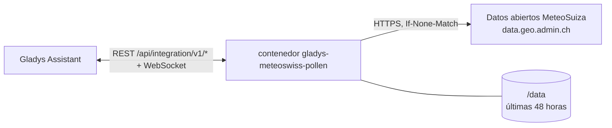
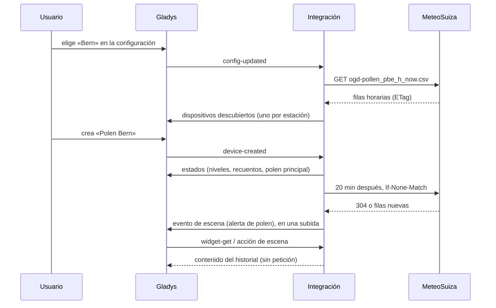
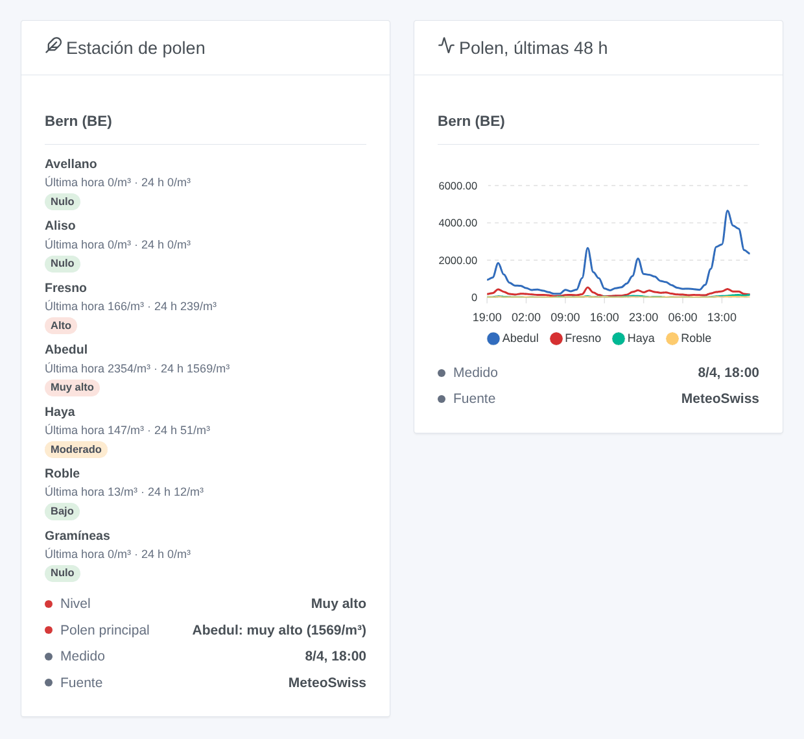

# Gladys MeteoSwiss Pollen

[English](README.md) · [Français](README.fr.md) · [Deutsch](README.de.md) · **Español**

[](LICENSE)
[](https://github.com/William-De71/gladys-meteoswiss-pollen/releases)
[](https://github.com/William-De71/gladys-meteoswiss-pollen/actions/workflows/release.yml)
[](https://gladysassistant.com)


Integración externa de [Gladys Assistant](https://gladysassistant.com) para el **polen medido cada hora por MeteoSuiza** en las estaciones de la red nacional suiza de medición de polen: avellano, aliso, fresno, abedul, haya, roble y gramíneas, con su nivel de nulo a muy alto. Datos públicos abiertos: sin cuenta ni clave.

Documentación de usuario: [English](docs/en.md) · [Français](docs/fr.md) · [Deutsch](docs/de.md) · [Español](docs/es.md).

> Integración comunitaria, no afiliada a MeteoSuiza. Fuente de los datos: MeteoSuiza. Son mediciones, no una previsión.

## Funcionalidades

- **Un dispositivo por estación**, hasta tres de las 15 estaciones con valores en tiempo real: Basel, Bern, Buchs SG, Davos, Genève, La Chaux-de-Fonds, Lausanne, Locarno, Lugano, Luzern, Münsterlingen, Neuchâtel, Payerne, Sion, Zürich.
- **Nivel de polen** actual (0 nulo a 4 muy alto). Para cada uno de los siete pólenes: el **recuento de la última hora** (pólenes por m³) y su **nivel** en las últimas 24 horas. Además, el **polen principal** como texto.
- Niveles según las **clases de carga polínica de MeteoSuiza**, polen por polen.
- **1 disparador de escena**, **1 acción de escena** y **2 widgets** (abajo).
- Lectura cada 20 minutos con peticiones condicionales (un archivo sin cambios responde 304); las últimas 48 horas se conservan entre reinicios.
- Cuatro idiomas en todas partes: inglés, francés, alemán, español.

## Funcionamiento




MeteoSuiza publica un archivo CSV por estación en la colección STAC `ch.meteoschweiz.ogd-pollen`. El archivo tiene una fila por hora con la concentración media de cada polen. Las horas están en UTC y marcan el final de la hora. La integración lee el archivo en tiempo real de cada estación (`…_h_now.csv`, unos 2 KB) cada 20 minutos, más un desfase fijo de cinco minutos como mucho. Fusiona las filas en un historial de 48 horas y calcula los niveles con la media de las últimas 24 horas. Cuando guarda menos de 24 horas (primer arranque, corte largo), lee una vez el archivo anual de la estación (`…_h_recent.csv`, unos 270 KB), como mucho cada seis horas. La abreviatura de MeteoSuiza de la estación (PBE, PZH…) identifica el dispositivo.



### Transporte

Solo en la nube (`"transports": ["cloud"]`): el catálogo muestra la insignia de nube. La integración lee `data.geo.admin.ch`, la plataforma de datos abiertos de la Confederación Suiza. Solo las peticiones de los archivos de las estaciones salen de su red. No hay alternativa local, así que no hay botón «Preferir la conexión local».

## Dispositivos y funcionalidades

| Funcionalidad                            | Categoría / tipo            | Valores                                 |
| ---------------------------------------- | --------------------------- | --------------------------------------- |
| Nivel de polen                           | `airquality-sensor` / `aqi` | 0 nulo … 4 muy alto (el polen más alto) |
| Polen avellano … gramíneas (última hora) | `airquality-sensor` / `aqi` | pólenes por m³, 0 … 20 000, sin unidad  |
| Nivel de polen avellano … gramíneas      | `airquality-sensor` / `aqi` | 0 … 4, media de las últimas 24 horas    |
| Polen principal                          | `text` / `text`             | «Abedul: alto (120/m³)», «-» si no hay  |

16 funcionalidades por dispositivo. Gladys no tiene unidad para el polen, y la unidad `aqi` sería errónea para un recuento o un nivel de 0 a 4: estas funcionalidades no tienen unidad. No se publica ningún valor cuando MeteoSuiza no lo da. Una estación que no publica nada nuevo durante seis horas queda desfasada: sus valores dejan de actualizarse. Los nombres de los dispositivos y el polen principal siguen el idioma configurado.

Clases de carga polínica de MeteoSuiza (pólenes/m³). Están pensadas para la media diaria; la integración las aplica a la media de las últimas 24 horas (al menos 18 horas medidas):

| Polen           | Bajo | Moderado | Alto    | Muy alto |
| --------------- | ---- | -------- | ------- | -------- |
| Avellano, aliso | 1–10 | 11–69    | 70–249  | ≥ 250    |
| Fresno          | 1–10 | 11–99    | 100–349 | ≥ 350    |
| Abedul          | 1–10 | 11–69    | 70–299  | ≥ 300    |
| Haya, roble     | 1–49 | 50–129   | 130–399 | ≥ 400    |
| Gramíneas       | 1–19 | 20–49    | 50–149  | ≥ 150    |

## Disparadores, acciones de escena y widgets



**Disparador de escena** **MeteoSuiza: alerta de polen**: un polen alcanza «Moderado» o más en una estación, o vuelve a subir el mismo día. Se activa como mucho una vez por nivel, estación, polen y día, y la primera lectura de una estación sirve de referencia. Filtros: estación, polen, niveles. Variables: estación, polen, nivel, media de 24 horas, última hora, hora de la medición y un resumen listo.

**Acción de escena**: **leer el polen** de una estación. Devuelve el nivel, el polen principal, un resumen, y la última hora y el nivel de cada uno de los siete pólenes (20 salidas) para las acciones siguientes.

**Widgets**: **Estación de polen** (los siete pólenes con su nivel, la última hora y la media de 24 horas, más el nivel global, el polen principal, la hora de la medición y la fuente) y **Polen, últimas 48 h** (gráfico horario de los cuatro pólenes con el pico más alto).

Ejemplos:

- Cuando el **abedul está alto** en Bern → enviar `{{triggerEvent.data.summary}}` y apagar la ventilación de los dormitorios.
- Cada mañana → **leer el polen** y enviar el resumen con el tiempo.
- Cuando las **gramíneas están muy altas** → recordar cerrar las ventanas antes de salir.

## Requisitos

- Gladys Assistant **5.3.0** o posterior (palabras clave y países del catálogo de Gladys 5.3, widgets y escenas de integraciones externas). Las instancias más antiguas no pueden instalar la integración.
- Acceso a Internet desde Gladys.

## Instalación

- **Desde la tienda** de Gladys (Integraciones → Integraciones externas), con un clic, una vez indexada.
- **Desde la URL del repositorio**: `https://github.com/William-De71/gladys-meteoswiss-pollen`.
- **Modo desarrollador**: construya la imagen en local (`docker build -t gladys-meteoswiss-pollen .`) e instálela desde Gladys.

## Configuración

| Campo                  | Descripción                                                                            |
| ---------------------- | -------------------------------------------------------------------------------------- |
| Estación 1             | La estación de polen más cercana a su casa, entre las 15. Obligatorio.                 |
| Estación 2, Estación 3 | Otras estaciones. Opcional.                                                            |
| Idioma de los textos   | Nombres de dispositivos, polen principal, resúmenes de escenas (automático: su panel). |

Botones: **Leer ahora** (no de nuevo en dos minutos si los datos son recientes) y **Diagnóstico** (escribe el estado de la integración en la pestaña Registros).

## Uso

1. Elija de una a tres estaciones y guarde.
2. En la pestaña **Descubrir**, cree el dispositivo «Polen …» de cada estación.
3. Añada los widgets **Estación de polen** y **Polen, últimas 48 h** a un panel, y cree escenas con el disparador de arriba.

## Desarrollo

```bash
npm install
npm test                       # node --test, nunca toca la red
npm run lint && npm run format:check
npx github:GladysAssistant/integration-store . --skip-image-check
scripts/build-cover.sh         # cover.jpg desde docs/assets/cover.svg
docs/illustrations/render.sh   # docs/assets/widgets.<idioma>.png
node .github/scripts/release.mjs next
```

En local, el SDK lee `GLADYS_HOST_API_URL`, `GLADYS_INTEGRATION_TOKEN` y `GLADYS_INTEGRATION_SELECTOR`. `DEBUG=gladys-integration-sdk` muestra los registros del SDK y comprueba cada contenido de widget. Las pruebas leen archivos reales de MeteoSuiza grabados en `test/fixtures/`. Las reglas del proyecto están en [CLAUDE.md](CLAUDE.md).

## Proceso de publicación


Cada fusión en `main` lanza la CI y calcula la versión a partir de los [Conventional Commits](https://www.conventionalcommits.org/) desde la última etiqueta: `feat` → menor, `fix` / `perf` → parche, `!` o `BREAKING CHANGE` → mayor (una menor por debajo de 1.0.0). `docs`, `chore`, `ci`, `test`, `style`, `refactor` y `build` solos no publican nada. El workflow genera entonces la sección del changelog, sube la etiqueta y construye la imagen multiarquitectura. Después, `main` recibe el commit de versión y se crea la GitHub Release. Un último job comprueba la imagen pública, el validador de la tienda y el topic.

- El título de la pull request se convierte en el commit squash y luego en la línea del changelog: escríbalo en inglés, para el usuario (`pr-title.yml` lo comprueba). No edite nunca `CHANGELOG.md` a mano.
- La 1.0.0 es una decisión: Actions → Release → Run workflow con `release-as: 1.0.0`. `dry-run` muestra la versión y las notas sin publicar.
- **Rama protegida**: la publicación sube su commit a `main` con `GITHUB_TOKEN`. Con un ruleset en `main` más estricto que «sin borrado ni force push», añada GitHub Actions a su lista de excepciones (o suba con una GitHub App). Si no, el job de publicación falla con instrucciones.
- Tras la primera versión, haga público el paquete de `ghcr.io` (Package settings → Change visibility); si no, Gladys no puede descargarlo.

## Solución de problemas

Vea [docs/es.md](docs/es.md#solución-de-problemas). Informe de los problemas con las versiones de Gladys y de la integración, las estaciones y las líneas del botón **Diagnóstico**.

## Contribuir

Las issues y pull requests son bienvenidas. Ejecute `npm run format:check && npm run lint && npm test` antes de abrir una pull request, y no cambie ningún identificador externo ni ninguna clave guardada (vea [CLAUDE.md](CLAUDE.md)). Si cambia el formato de los archivos, grabe primero un archivo nuevo en `test/fixtures/` y luego corrija el lector.

## Seguridad

Vea [SECURITY.md](SECURITY.md): informe de las vulnerabilidades en privado. La integración no tiene ningún secreto que guardar. Solo pide archivos públicos, con un user agent que nombra el proyecto.

## Capturas por venir

Las imágenes de arriba son ilustraciones, no capturas de pantalla. Las capturas reales irán en `docs/assets/screenshots/` (PNG, 1280 × 800): `configuration.png`, `discovery.png`, `device.png`, `scene.png`.

## Licencia

[Licencia Apache 2.0](LICENSE) — vea también [NOTICE](NOTICE). Los datos de polen son datos públicos abiertos de MeteoSuiza (Fuente: MeteoSuiza); los widgets muestran su fuente. Gracias a la documentación y al SDK de Gladys, y a MeteoSuiza por abrir sus mediciones.
