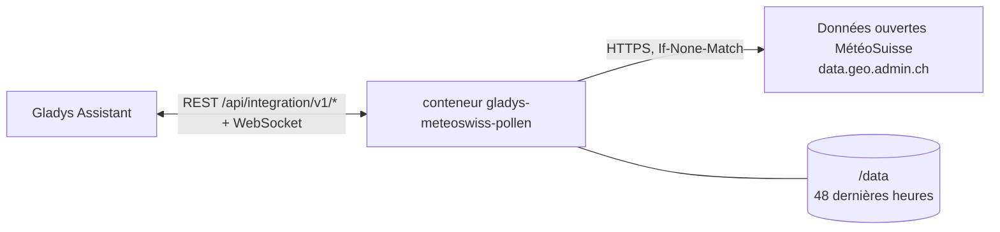
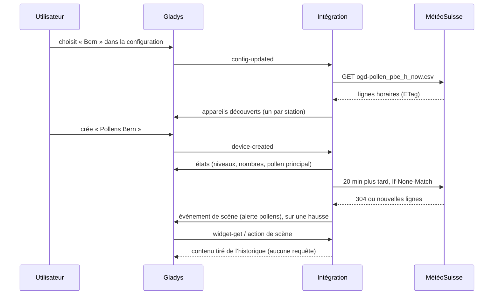
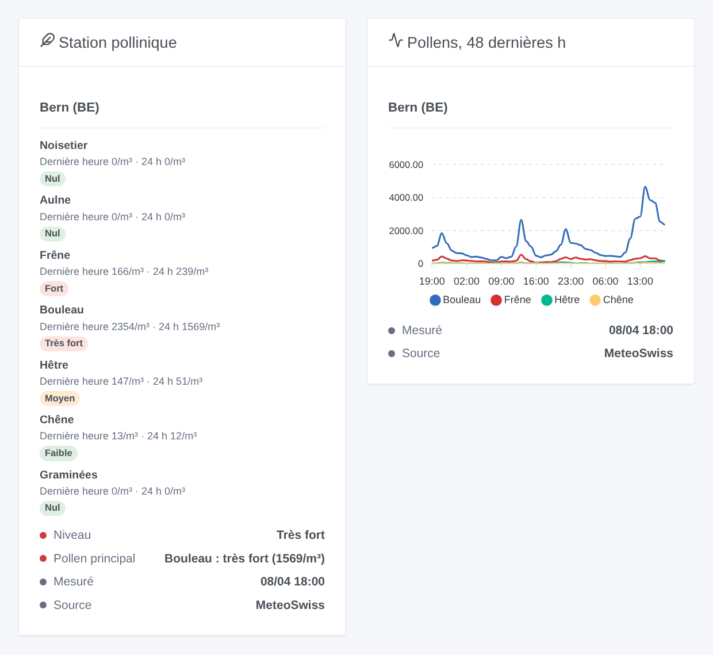

# Gladys MeteoSwiss Pollen

[English](README.md) · **Français** · [Deutsch](README.de.md) · [Español](README.es.md)

[](LICENSE)
[](https://github.com/William-De71/gladys-meteoswiss-pollen/releases)
[](https://github.com/William-De71/gladys-meteoswiss-pollen/actions/workflows/release.yml)
[](https://gladysassistant.com)


Intégration externe [Gladys Assistant](https://gladysassistant.com) pour les **pollens mesurés chaque heure par MétéoSuisse** aux stations du réseau national de mesure des pollens : noisetier, aulne, frêne, bouleau, hêtre, chêne et graminées, avec leur niveau, de nul à très fort. Données publiques ouvertes : sans compte ni clé.

Documentation utilisateur : [English](docs/en.md) · [Français](docs/fr.md) · [Deutsch](docs/de.md) · [Español](docs/es.md).

> Intégration communautaire, non affiliée à MétéoSuisse. Source des données : MétéoSuisse. Ce sont des mesures, pas une prévision.

## Fonctionnalités

- **Un appareil par station**, jusqu’à trois des 15 stations qui publient en temps réel : Basel, Bern, Buchs SG, Davos, Genève, La Chaux-de-Fonds, Lausanne, Locarno, Lugano, Luzern, Münsterlingen, Neuchâtel, Payerne, Sion, Zürich.
- **Niveau de pollens** actuel (0 nul à 4 très fort). Pour chacun des sept pollens : le **nombre de la dernière heure** (pollens par m³) et son **niveau** sur les dernières 24 heures. S’y ajoute le **pollen principal** en texte.
- Niveaux tirés des **classes de charge pollinique de MétéoSuisse**, pollen par pollen.
- **1 déclencheur de scène**, **1 action de scène** et **2 widgets** (ci-dessous).
- Lecture toutes les 20 minutes par requêtes conditionnelles (un fichier inchangé répond 304) ; les 48 dernières heures sont gardées entre deux redémarrages.
- Quatre langues partout : anglais, français, allemand, espagnol.

## Fonctionnement




MétéoSuisse publie un fichier CSV par station dans la collection STAC `ch.meteoschweiz.ogd-pollen`. Le fichier compte une ligne par heure, avec la concentration moyenne de chaque pollen. Les heures sont en UTC et marquent la fin de l’heure. L’intégration lit le fichier temps réel de chaque station (`…_h_now.csv`, environ 2 Ko) toutes les 20 minutes, plus un décalage stable de cinq minutes au plus. Elle fusionne les lignes dans un historique de 48 heures et calcule les niveaux sur la moyenne des dernières 24 heures. Quand elle garde moins de 24 heures (premier démarrage, longue coupure), elle lit une fois le fichier annuel de la station (`…_h_recent.csv`, environ 270 Ko), au plus toutes les six heures. L’abréviation MétéoSuisse de la station (PBE, PZH…) identifie l’appareil.



### Transport

Cloud uniquement (`"transports": ["cloud"]`) : le catalogue affiche le badge cloud. L’intégration lit `data.geo.admin.ch`, la plateforme de données ouvertes de la Confédération. Seules les demandes des fichiers des stations quittent votre réseau. Il n’y a pas d’alternative locale, donc pas de bouton « Préférer la connexion locale ».

## Appareils et fonctionnalités

| Fonctionnalité                                 | Catégorie / type            | Valeurs                                   |
| ---------------------------------------------- | --------------------------- | ----------------------------------------- |
| Niveau de pollens                              | `airquality-sensor` / `aqi` | 0 nul … 4 très fort (pollen le plus haut) |
| Pollens noisetier … graminées (dernière heure) | `airquality-sensor` / `aqi` | pollens par m³, 0 … 20 000, sans unité    |
| Niveau pollens noisetier … graminées           | `airquality-sensor` / `aqi` | 0 … 4, moyenne des dernières 24 heures    |
| Pollen principal                               | `text` / `text`             | « Bouleau : fort (120/m³) », « - » sinon  |

16 fonctionnalités par appareil. Gladys n’a pas d’unité pour les pollens, et l’unité `aqi` serait fausse pour un nombre ou un niveau de 0 à 4 : ces fonctionnalités n’ont pas d’unité. Aucune valeur n’est publiée quand MétéoSuisse n’en donne pas. Une station qui ne publie rien de neuf pendant six heures est périmée : ses valeurs ne sont plus mises à jour. Les noms des appareils et le pollen principal suivent la langue configurée.

Classes de charge pollinique de MétéoSuisse (pollens/m³). Elles sont prévues pour la moyenne journalière ; l’intégration les applique à la moyenne des dernières 24 heures (au moins 18 heures mesurées) :

| Pollen           | Faible | Moyen  | Fort    | Très fort |
| ---------------- | ------ | ------ | ------- | --------- |
| Noisetier, aulne | 1–10   | 11–69  | 70–249  | ≥ 250     |
| Frêne            | 1–10   | 11–99  | 100–349 | ≥ 350     |
| Bouleau          | 1–10   | 11–69  | 70–299  | ≥ 300     |
| Hêtre, chêne     | 1–49   | 50–129 | 130–399 | ≥ 400     |
| Graminées        | 1–19   | 20–49  | 50–149  | ≥ 150     |

## Déclencheurs, actions de scène et widgets



**Déclencheur de scène** **MétéoSuisse : alerte pollens** : un pollen atteint « Moyen » ou plus à une station, ou remonte le même jour. Il se déclenche au plus une fois par niveau, station, pollen et jour, et la première lecture d’une station sert de référence. Filtres : station, pollen, niveaux. Variables : station, pollen, niveau, moyenne sur 24 heures, dernière heure, heure de la mesure et un résumé tout prêt.

**Action de scène** : **lire les pollens** d’une station. Elle renvoie le niveau, le pollen principal, un résumé, ainsi que la dernière heure et le niveau de chacun des sept pollens (20 sorties) pour les actions suivantes.

**Widgets** : **Station pollinique** (les sept pollens avec leur niveau, la dernière heure et la moyenne sur 24 heures, puis le niveau global, le pollen principal, l’heure de la mesure et la source) et **Pollens, 48 dernières h** (graphique horaire des quatre pollens au plus fort pic).

Exemples :

- Quand le **bouleau est fort** à Bern → envoyer `{{triggerEvent.data.summary}}` et couper la ventilation des chambres.
- Chaque matin → **lire les pollens** et envoyer le résumé avec la météo.
- Quand les **graminées sont très fortes** → rappeler de fermer les fenêtres avant de partir.

## Prérequis

- Gladys Assistant **5.3.0** ou plus récent (mots-clés et pays du catalogue de Gladys 5.3, widgets et scènes des intégrations externes). Les instances plus anciennes ne peuvent pas installer l’intégration.
- Un accès à Internet depuis Gladys.

## Installation

- **Depuis le store** de Gladys (Intégrations → Intégrations externes), en un clic, une fois indexée.
- **Depuis l’URL du dépôt** : `https://github.com/William-De71/gladys-meteoswiss-pollen`.
- **Mode développeur** : construisez l’image en local (`docker build -t gladys-meteoswiss-pollen .`) et installez-la depuis Gladys.

## Configuration

| Champ                | Description                                                                                     |
| -------------------- | ----------------------------------------------------------------------------------------------- |
| Station 1            | La station pollinique la plus proche de chez vous, parmi les 15. Obligatoire.                   |
| Station 2, Station 3 | D’autres stations. Facultatif.                                                                  |
| Langue des textes    | Noms des appareils, pollen principal, résumés des scènes (automatique : votre tableau de bord). |

Boutons : **Lire maintenant** (pas de nouvelle lecture dans les deux minutes si les données sont fraîches) et **Diagnostic** (écrit l’état de l’intégration dans l’onglet Journaux).

## Utilisation

1. Choisissez une à trois stations, puis enregistrez.
2. Dans l’onglet **Découverte**, créez l’appareil « Pollens … » de chaque station.
3. Ajoutez les widgets **Station pollinique** et **Pollens, 48 dernières h** à un tableau de bord, et créez des scènes avec le déclencheur ci-dessus.

## Développement

```bash
npm install
npm test                       # node --test, ne touche jamais le réseau
npm run lint && npm run format:check
npx github:GladysAssistant/integration-store . --skip-image-check
scripts/build-cover.sh         # cover.jpg depuis docs/assets/cover.svg
docs/illustrations/render.sh   # docs/assets/widgets.<langue>.png
node .github/scripts/release.mjs next
```

En local, le SDK lit `GLADYS_HOST_API_URL`, `GLADYS_INTEGRATION_TOKEN` et `GLADYS_INTEGRATION_SELECTOR`. `DEBUG=gladys-integration-sdk` affiche les journaux du SDK et vérifie chaque contenu de widget. Les tests lisent de vrais fichiers de MétéoSuisse enregistrés dans `test/fixtures/`. Les règles du projet sont dans [CLAUDE.md](CLAUDE.md).

## Publication des versions


Chaque fusion sur `main` lance la CI, puis calcule la version à partir des [Conventional Commits](https://www.conventionalcommits.org/) depuis le dernier tag : `feat` → mineure, `fix` / `perf` → correctif, `!` ou `BREAKING CHANGE` → majeure (une mineure sous 1.0.0). `docs`, `chore`, `ci`, `test`, `style`, `refactor` et `build` seuls ne publient rien. Le workflow génère ensuite la section du changelog, pousse le tag et construit l’image multi-architecture. Puis `main` reçoit le commit de version et la GitHub Release est créée. Un dernier job vérifie l’image publique, le validateur du store et le topic.

- Le titre de la pull request devient le commit squash, puis la ligne du changelog : écrivez-le en anglais, pour l’utilisateur (`pr-title.yml` le vérifie). Ne modifiez jamais `CHANGELOG.md` à la main.
- La 1.0.0 est une décision : Actions → Release → Run workflow avec `release-as: 1.0.0`. `dry-run` affiche la version et les notes sans rien publier.
- **Branche protégée** : la publication pousse son commit sur `main` avec `GITHUB_TOKEN`. Avec un ruleset sur `main` plus strict que « ni suppression ni force-push », ajoutez GitHub Actions à sa liste de contournement (ou passez par une GitHub App). Sinon, le job de publication échoue avec les instructions.
- Après la première version, rendez public le paquet `ghcr.io` (Package settings → Change visibility), sinon Gladys ne peut pas le télécharger.

## Dépannage

Voir [docs/fr.md](docs/fr.md#dépannage). Signalez un problème avec les versions de Gladys et de l’intégration, les stations et les lignes du bouton **Diagnostic**.

## Contribuer

Les issues et pull requests sont les bienvenues. Lancez `npm run format:check && npm run lint && npm test` avant d’ouvrir une pull request, et ne changez aucun identifiant externe ni aucune clé enregistrée (voir [CLAUDE.md](CLAUDE.md)). Si le format des fichiers change, enregistrez un nouveau fichier dans `test/fixtures/` avant de corriger le lecteur.

## Sécurité

Voir [SECURITY.md](SECURITY.md) : signalez les vulnérabilités en privé. L’intégration n’a aucun secret à garder. Elle ne demande que des fichiers publics, avec un user agent qui nomme le projet.

## Captures à venir

Les images ci-dessus sont des illustrations, pas des captures d’écran. Les vraies captures iront dans `docs/assets/screenshots/` (PNG, 1280 × 800) : `configuration.png`, `discovery.png`, `device.png`, `scene.png`.

## Licence

[Licence Apache 2.0](LICENSE) — voir aussi [NOTICE](NOTICE). Les données de pollens sont des données publiques ouvertes de MétéoSuisse (Source : MétéoSuisse) ; les widgets affichent leur source. Merci à la documentation et au SDK de Gladys, et à MétéoSuisse d’ouvrir ses mesures.
