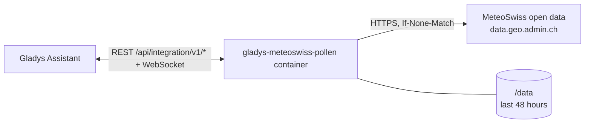
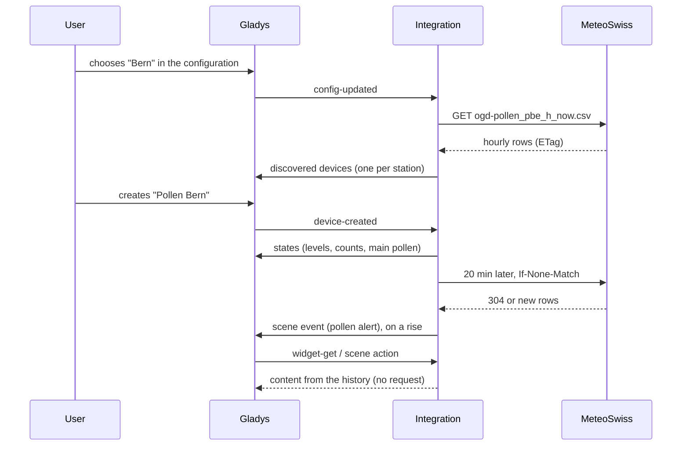
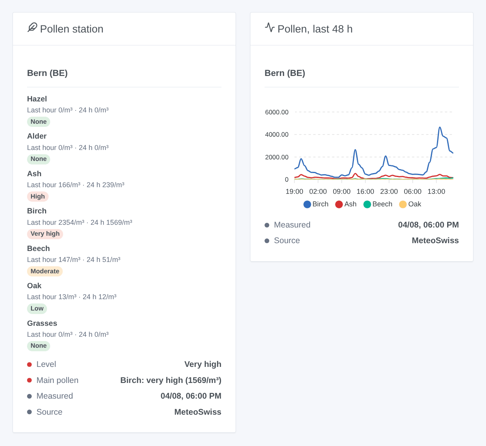

# Gladys MeteoSwiss Pollen

**English** · [Français](README.fr.md) · [Deutsch](README.de.md) · [Español](README.es.md)

[](LICENSE)
[](https://github.com/William-De71/gladys-meteoswiss-pollen/releases)
[](https://github.com/William-De71/gladys-meteoswiss-pollen/actions/workflows/release.yml)
[](https://gladysassistant.com)


[Gladys Assistant](https://gladysassistant.com) external integration for the **pollen measured every hour by MeteoSwiss** at the stations of the Swiss national pollen monitoring network: hazel, alder, ash, birch, beech, oak and grasses, with their level from none to very high. Open government data: no account, no key.

User documentation: [English](docs/en.md) · [Français](docs/fr.md) · [Deutsch](docs/de.md) · [Español](docs/es.md).

> Community integration, not affiliated with MeteoSwiss. Source of the data: MeteoSwiss. These are measurements, not a forecast.

## Features

- **One device per station**, up to three of the 15 stations with real-time values: Basel, Bern, Buchs SG, Davos, Genève, La Chaux-de-Fonds, Lausanne, Locarno, Lugano, Luzern, Münsterlingen, Neuchâtel, Payerne, Sion, Zürich.
- **Pollen level** now (0 none to 4 very high), and for each of the seven pollens the **count of the last hour** (pollen per m³) and its **level** over the last 24 hours, plus the **main pollen** as text.
- Levels from the **pollen load classes of MeteoSwiss**, pollen by pollen.
- **1 scene trigger**, **1 scene action** and **2 dashboard widgets** (below).
- Read every 20 minutes with conditional requests (an unchanged file answers 304); the last 48 hours are kept across restarts.
- Four languages everywhere: English, French, German, Spanish.

## How it works




MeteoSwiss publishes one CSV file per station in the STAC collection `ch.meteoschweiz.ogd-pollen`. The file holds one row per hour, with the mean concentration of each pollen. Times are in UTC and mark the end of the hour. The integration reads the real-time file of each station (`…_h_now.csv`, about 2 KB) every 20 minutes, plus a stable offset of up to five minutes. It merges the rows into a 48-hour history and works out the levels from the mean of the last 24 hours. When fewer than 24 hours are kept (first start, long outage), it reads the yearly file of the station once (`…_h_recent.csv`, about 270 KB), at most every six hours. The MeteoSwiss abbreviation of the station (PBE, PZH…) identifies the device.



### Transport

Cloud only (`"transports": ["cloud"]`): the catalog shows the cloud badge. The integration reads `data.geo.admin.ch`, the open data platform of the Swiss federal government. Only the requests for the station files leave your network. There is no local alternative, so there is no "prefer the local connection" button.

## Devices and features

| Feature                            | Category / type             | Values                                |
| ---------------------------------- | --------------------------- | ------------------------------------- |
| Pollen level                       | `airquality-sensor` / `aqi` | 0 none … 4 very high (highest pollen) |
| Hazel … grasses pollen (last hour) | `airquality-sensor` / `aqi` | pollen per m³, 0 … 20 000, no unit    |
| Hazel … grasses pollen level       | `airquality-sensor` / `aqi` | 0 … 4, mean of the last 24 hours      |
| Main pollen                        | `text` / `text`             | "Birch: high (120/m³)", "-" when none |

16 features per device. Gladys has no pollen unit, and the `aqi` unit would be wrong for a count or a level from 0 to 4, so these features have no unit. No value is published when MeteoSwiss gives none. A station that publishes nothing new for six hours is stale: its values are no longer updated. The device names and the main pollen follow the configured language.

Pollen load classes of MeteoSwiss (pollen/m³), meant for the daily mean and applied to the mean of the last 24 hours (at least 18 measured hours):

| Pollen       | Low  | Moderate | High    | Very high |
| ------------ | ---- | -------- | ------- | --------- |
| Hazel, alder | 1–10 | 11–69    | 70–249  | ≥ 250     |
| Ash          | 1–10 | 11–99    | 100–349 | ≥ 350     |
| Birch        | 1–10 | 11–69    | 70–299  | ≥ 300     |
| Beech, oak   | 1–49 | 50–129   | 130–399 | ≥ 400     |
| Grasses      | 1–19 | 20–49    | 50–149  | ≥ 150     |

## Scene triggers, actions and widgets



**Scene trigger** **MeteoSwiss: pollen alert**: a pollen reaches "Moderate" or more at a station, or rises again the same day. It fires at most once per level, station, pollen and day, and the first reading of a station is a reference. Filters: station, pollen, levels. Variables: station, pollen, level, 24-hour mean, last hour, time of the measurement and a ready-made summary.

**Scene action**: **read the pollen** of a station. It returns the level, the main pollen, a summary, and the last hour and level of each of the seven pollens (20 outputs) for the following actions.

**Widgets**: **Pollen station** (the seven pollens with their level, the last hour and the 24-hour mean, the overall level, the main pollen, the time of the measurement and the source) and **Pollen, last 48 h** (hourly chart of the four pollens with the highest peak).

Examples:

- When **birch is high** in Bern → send `{{triggerEvent.data.summary}}` and stop the ventilation of the bedrooms.
- Every morning → **read the pollen** and send the summary with the weather.
- When **grasses are very high** → remind to close the windows before leaving.

## Requirements

- Gladys Assistant **5.3.0** or later (catalog keywords and countries of Gladys 5.3, widgets and scenes of external integrations). Older instances cannot install the integration.
- Access to the internet from Gladys.

## Installation

- **From the store** of Gladys (Integrations → External integrations), in one click, once indexed.
- **From the repository URL**: `https://github.com/William-De71/gladys-meteoswiss-pollen`.
- **Developer mode**: build the image locally (`docker build -t gladys-meteoswiss-pollen .`) and install it from Gladys.

## Configuration

| Field                 | Description                                                             |
| --------------------- | ----------------------------------------------------------------------- |
| Station 1             | The pollen station nearest to your home, among the 15. Required.        |
| Station 2, Station 3  | Other stations. Optional.                                               |
| Language of the texts | Device names, main pollen, scene summaries (automatic: your dashboard). |

Buttons: **Read now** (not again within two minutes when the data are fresh) and **Diagnostic** (writes the state of the integration to the Logs tab).

## Usage

1. Choose one to three stations, then save.
2. In the **Discover** tab, create the "Pollen …" device of each station.
3. Add the **Pollen station** and **Pollen, last 48 h** widgets to a dashboard, and build scenes with the trigger above.

## Development

```bash
npm install
npm test                       # node --test, never touches the network
npm run lint && npm run format:check
npx github:GladysAssistant/integration-store . --skip-image-check
scripts/build-cover.sh         # cover.jpg from docs/assets/cover.svg
docs/illustrations/render.sh   # docs/assets/widgets.<lang>.png
node .github/scripts/release.mjs next
```

Locally, the SDK reads `GLADYS_HOST_API_URL`, `GLADYS_INTEGRATION_TOKEN` and `GLADYS_INTEGRATION_SELECTOR`. `DEBUG=gladys-integration-sdk` shows the SDK logs and checks every widget content. The tests read real files of MeteoSwiss recorded in `test/fixtures/`. The rules of the project are in [CLAUDE.md](CLAUDE.md).

## Release process


Every merge on `main` runs the CI, then computes the version from the [Conventional Commits](https://www.conventionalcommits.org/) since the last tag: `feat` → minor, `fix` / `perf` → patch, `!` or `BREAKING CHANGE` → major (a minor below 1.0.0). `docs`, `chore`, `ci`, `test`, `style`, `refactor` and `build` alone publish nothing. The workflow then generates the changelog section, pushes the tag and builds the multi-architecture image. After that, `main` receives the release commit and the GitHub Release is created. A last job checks the public image, the store validator and the topic.

- The pull request title becomes the squash commit, then the changelog line: write it in English, for the user (`pr-title.yml` checks it). Never edit `CHANGELOG.md` by hand.
- 1.0.0 is a decision: Actions → Release → Run workflow with `release-as: 1.0.0`. `dry-run` shows the version and the notes without publishing.
- **Protected branch**: the release pushes its commit to `main` with `GITHUB_TOKEN`. With a ruleset on `main` stricter than "no deletion, no force push", add GitHub Actions to its bypass list (or push through a GitHub App). Otherwise the publish job fails with instructions.
- After the first release, make the `ghcr.io` package public (Package settings → Change visibility), or Gladys cannot pull it.

## Troubleshooting

See [docs/en.md](docs/en.md#troubleshooting). Report issues with the versions of Gladys and of the integration, the stations, and the lines of the **Diagnostic** button.

## Contributing

Issues and pull requests are welcome. Run `npm run format:check && npm run lint && npm test` before opening a pull request, and keep every external id and stored key unchanged (see [CLAUDE.md](CLAUDE.md)). If the format of the files changes, record a new file in `test/fixtures/` before fixing the reader.

## Security

See [SECURITY.md](SECURITY.md): report vulnerabilities privately. The integration has no secret to keep. It only asks for public files, with a user agent naming the project.

## Screenshots to come

The images above are illustrations, not screenshots. Real screenshots will go in `docs/assets/screenshots/` (PNG, 1280 × 800): `configuration.png`, `discovery.png`, `device.png`, `scene.png`.

## License

[Apache License 2.0](LICENSE) — see also [NOTICE](NOTICE). The pollen data are open government data of MeteoSwiss (Source: MeteoSwiss); the widgets show their source. Thanks to the Gladys documentation and SDK, and to MeteoSwiss for opening its measurements.
